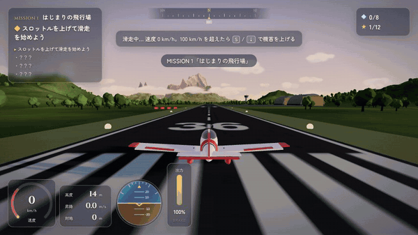

# Skybound Horizons — 蒼穹の冒険

祖父が遺した古い飛行日誌を手に、地図にない空へ。
**Skybound Horizons** は、ブラウザで遊べる三人称視点の 3D フライトアドベンチャーです。戦闘はありません。小さなプロペラ機で滑走路から飛び立ち、海と島々、雲海に沈む山脈、霧に隠された幻の島を自分の目で見つけ、最後は秘密の滑走路に降り立ちます。

**▶ ブラウザで遊ぶ：https://onego15.github.io/skyodyssey-claude/** （GitHub Pages）



> 上の GIF は実際のゲームを headless Chromium で動かして録画したものです（後述「動作確認結果」参照）。長めのプレイ動画（約 94 秒：離陸 → 灯台の島へ着陸・停止 → 峡谷 → 遺跡の発見 → 幻の島の秘密の滑走路へ着陸・停止）は [`docs/gameplay.mp4`](docs/gameplay.mp4) にあります。MP4 は別々に録画した場面をつないだもので、どの場面も実際のゲーム映像です。

---

## ゲームの特徴

- **離陸と着陸が主役のアーケード寄り飛行モデル**
  - 滑走路に停止した状態から、スロットルで出力を上げて加速 → 約 100 km/h で機首を上げて離陸。速度が足りないと揚力が足りず浮きません（揚力・抗力・推力を毎フレーム計算）。
  - 地上滑走中は前輪ステアリング、エレベーターは速度に応じて効き始め、浮いた瞬間に空中の挙動へ滑らかに移行します。
  - 着陸は「降下率・機体の傾き・機首角・地面の傾斜」で判定。初心者向けに許容範囲は広め（降下率 6 m/s 未満、傾き 24° 未満など）で、接地の強さで「すばらしい着陸／なめらかな着陸／ハードランディング（1回バウンド）」に評価が変わります。
  - 接地時はタイヤのスキール音・ドスンという低音・タイヤの白煙・カメラの揺れ・サスペンションの沈み込みで手応えを演出。
  - 滑走路脇には実物と同じ考え方の **PAPI（進入角指示灯）**。白2・赤2 なら理想の降下角です。HUD にも同じ表示が出ます。
- **操縦アシスト（既定 ON）**：キーを離すと翼が水平に戻り、飛行経路はゆっくり水平へ。A/D は「バンク角指令（最大 60°）」になり、旋回中も高度を保ちやすくなっています。設定で OFF にすると、ロール・ループも可能な自由な操縦になります。
- **探索と発見が報酬**：12 か所の「発見」ポイント（海の門、白亜の灯台、沈んだ柱廊、雲海、巨人の峡谷、双子の滝、天嶺、風の神殿、幻の島、浮遊岩、秘密の滑走路…）。近づくと画面にタイトルが現れ、チャイムとともにスローモーションのシネマティックカメラが景色と機体を同時に映します。
- **収集要素**：世界のあちこちに 8 個の「スカイクリスタル」（アーチの下、灯台の真上、峡谷の底、最高峰の頂、浮遊岩の下 など）。
- **冒険日誌と地図（M キー）**：飛んだ場所だけが羊皮紙風の地図に描かれていく（未踏の地は霧で隠れる）。発見した場所の説明とクリスタルのヒントを記録。
- **景観**：手続き生成した島々・山脈・峡谷・カルデラ、浅瀬で色が変わる海面シェーダー（波・フレネル反射・太陽のきらめき・磯の白波）、空のシェーダー、積雲、山を覆う多層の雲海、霧の壁、約 1 万 7 千本の木々。時間帯（朝・昼・夕方・夕暮れ）でライティング、霧、海と雲の色が変わります。
- **カメラワーク**：速度と旋回に遅れて追従するチェイスカメラ（速度で FOV が広がる、旋回でわずかにロール）、離陸の瞬間の滑走路脇ショット、発見時のシネマティック、着陸停止後のオービット。C キーで追従／遠景／コックピット／フライバイを切替。マウスドラッグで見回し。
- **サウンド（すべてプログラムで合成）**：回転数に追従するエンジン音とプロペラのうなり、速度で強まる風切り音、タイヤの転がり音、失速警報、発見チャイム、ミッションの時間帯ごとに和音が変わる生成型 BGM（パッド、ハープ風アルペジオ、フルート風メロディ）。
- **墜落しても自然にリトライ**：Enter で「少し前の安全な飛行地点」から再開（空中スナップショット）、または最初から。ミッションの進行や発見済みの記録は壊れません。

## ミッション紹介

| # | ミッション | 時間帯 | 目的と達成条件 |
|---|---|---|---|
| 1 | **はじまりの飛行場** | 朝 | 滑走路で停止した状態から離陸 → 北東の「灯台の島」を見つける → 灯台の島の草の滑走路に着陸して停止。各段階で操作のコツが表示されるチュートリアルを兼ねます。寄り道に「海の門」くぐり。 |
| 2 | **雲海の向こう** | 昼 | 灯台の島から離陸し、北西の山脈へ。目印はなく、日誌の手がかり「川をさかのぼれ」と画面右上の **共鳴計**（遺跡に近づくほど光る）だけを頼りに、雲海の下の峡谷を遡って「風の神殿」を発見 → 遺跡が目覚め光の柱が立つ → 山麓の滑走路に着陸して停止。 |
| 3 | **幻の島** | 夕暮れ | 神殿から東の海へ伸びる光の帯を追う → 霧の壁を抜けると、遠くからは見えなかった島が姿を現す → カルデラの外輪山にある「石の門」から低く進入し、秘密の石畳の滑走路を見つけて着陸・停止 → エンディング。 |
| – | **フリーフライト** | 選択 | 出発地（各滑走路／上空）と時間帯を選んで自由に探検。 |

ミッションは順番に遊ぶのがおすすめですが、すべて最初から選択できます。進行・発見・クリスタルはブラウザの localStorage に保存されます。

## 操作方法

| キー | 操作 |
|---|---|
| `S` / `↓` | 機首を上げる（操縦桿を引く） |
| `W` / `↑` | 機首を下げる（押す）※設定で上下反転可 |
| `A` `D` / `←` `→` | 機体を傾けて旋回 |
| `Q` `E` | ラダー（地上では前輪ステアリング） |
| `R` / `Shift` / マウスホイール | スロットルを上げる |
| `F` / `Ctrl` | スロットルを下げる |
| `Space` / `B` | ブレーキ（地上） |
| `C` | カメラ切替　／　マウスドラッグ：見回し |
| `M` | 地図と冒険日誌 |
| `Esc` / `P` | 一時停止メニュー |
| `Enter` / `Backspace` | 墜落時：少し前から再開 ／ 最初から |
| `H` | ヒント表示の切替 |

ゲームパッドにも簡易対応しています（左スティック：ピッチ/ロール、トリガー：スロットル、A：ブレーキ）。

**離陸**：`R` を押し続けて出力 80% 以上 → 滑走して 100 km/h を超えたら `S` で機首を上げる。
**着陸**：滑走路の延長線上から出力を 20〜40% に下げ、120〜150 km/h で降下。PAPI が白2・赤2 になるよう高度を合わせ、接地直前に少しだけ `S`（フレア）。接地したら出力 0 で `Space`。

## 起動方法

すぐに遊ぶなら GitHub Pages 版（https://onego15.github.io/skyodyssey-claude/ ）を開いてください。手元で動かす場合は以下の通りです。

ビルド不要の静的サイトです（ES Modules を使うため、`file://` ではなくローカル HTTP サーバー経由で開いてください）。

```bash
git clone https://github.com/onego15/skyodyssey-claude.git
cd skyodyssey-claude
npx http-server -p 8080 -c-1     # または: python3 -m http.server 8080
# ブラウザで http://localhost:8080/ を開く
```

- 推奨：デスクトップ版 Chrome / Edge / Firefox（WebGL2）、キーボード。
- 画質はタイトルの「設定」から 高/中/低 を選べます（URL に `?quality=low` を付けても可）。
- 初回クリックでサウンドが有効になります（ブラウザの自動再生制限のため）。
- GitHub Pages などの静的ホスティングにそのまま置いても動作します。

## 使用した AI サービスとモデル

- **AI サービス**：Anthropic **Claude Code**（claude.ai のクラウド実行環境から実行。Claude Projects のスレッドで依頼を受けて自律制作）
- **モデル名**：この制作環境では、リポジトリに push するファイルにモデル識別子を書き込まないよう定められているため、README には記載していません。依頼スレッドへの報告メッセージで、セッション情報から確認したモデル名を伝えています。
- 企画・設計・コード・シェーダー・サウンド合成・テストスクリプト・README はすべて上記 AI が作成しました。外部の画像・音声・3D モデル素材は使用していません。

## 使用技術・ゲームエンジン

- **言語**：JavaScript（ES Modules）、GLSL、HTML / CSS
- **3D エンジン**：[three.js](https://threejs.org/) r180（MIT License、`vendor/three/` に同梱。`BufferGeometryUtils` のみ addons から使用）
- **地形**：シード付き Simplex ノイズ（fBm / リッジノイズ）による解析的な高さ関数 → 島ごとの高さグリッドを生成。衝突判定は描画メッシュと同じ三角形分割で補間するので、見た目と当たり判定が一致します。
- **独自シェーダー**：空（大気グラデーション・太陽・星）、海（タイル法線マップの多層スクロール、浅瀬の深度テクスチャ、フレネル、スペキュラ、白波）、雲海（多層ノイズ）、インスタンス描画のビルボード雲、幻の島の「蜃気楼」フォグ。
- **機体**：すべてプリミティブとラセ回転体から組み立てたオリジナルの低翼プロペラ機（動く補助翼・昇降舵・方向舵・プロペラ・車輪）。PMREM による空の環境反射。
- **サウンド**：Web Audio API でリアルタイム合成（音声ファイルなし）。
- **フォント**：Google Fonts（Zen Maru Gothic / Cinzel）。オフライン時はシステムフォントで表示されます。
- **テスト・録画**：Playwright + headless Chromium（SwiftShader によるソフトウェア WebGL）、ffmpeg。

```
index.html / style.css     画面とHUD
src/main.js                ゲーム本体（状態遷移・ループ・発見・リトライ・テストAPI）
src/plane.js               機体モデルと飛行モデル（離陸・着陸判定・衝突）
src/terrain.js layout.js   地形生成と世界のレイアウト
src/world.js props.js      空・海・雲・雲海・霧、滑走路・建物・遺跡・木・クリスタル
src/camera.js              カメラリグとシネマティック
src/audio.js effects.js    サウンド合成、煙・飛行機雲などのエフェクト
src/missions.js hud.js     ミッション定義、HUD・地図・日誌
src/autopilot.js           自動テスト用オートパイロット（通常プレイでは使われません）
tools/                     Playwright による自動プレイテスト・撮影・録画スクリプト
```

## 制作に使用した依頼プロンプト（全文）

```text
スカイオデッセイ（Sky Odyssey）に着想を得た、3Dフライトアドベンチャーゲームを制作してください。
単なるフライトシミュレーターではなく、飛行機を操って未知の世界を探検し、美しい景色や失われた遺跡を発見する、冒険心を刺激するゲームを目指してください。
ブラウザで快適に動作し、商業インディーゲームのような完成度を目標とします。
最も重視するのは、空を飛ぶ楽しさ、未知の世界を発見する冒険感、美しい3D景観、離陸と着陸の操縦体験、臨場感のあるカメラワークです。
ゲームの方向性

* 三人称視点の3Dフライトアドベンチャー
* 戦闘は不要
* 難易度は低〜中程度で、初心者でも楽しめる
* 飛行の自由度を確保し、未知の場所を探索する楽しさを重視する
* 単にチェックポイントを順番に通過するだけのゲームにはしない
* 美しい風景、隠された場所、発見時の演出によって冒険感を生み出す

飛行操作
リアルすぎないアーケード寄りの飛行モデルを採用しながら、飛行機らしい操縦体験を実現してください。
特に離陸と着陸は丁寧に実装してください。
離陸

* 滑走路上で停止した状態から開始する
* スロットル操作でエンジン出力を調整する
* 滑走路を加速し、十分な速度になったら機首を上げて離陸する
* 速度不足では自然に離陸できないようにする
* 地上滑走から空中飛行への移行を滑らかに表現する

着陸

* 自分で滑走路を見つけて進入する
* スロットル、ピッチ、ロールを使って高度と速度を調整する
* 降下、接地、減速、停止まで操作できる
* 接地速度や機体姿勢によって着陸の成否が変わる
* 判定は初心者向けに適度な許容範囲を設ける
* 着陸時の効果音、車輪の接地、機体の揺れなどで達成感を演出する

冒険・探索
以下の3つの冒険を体験できるようにしてください。

1. はじまりの飛行場：離陸と着陸を学びながら、近くの島へ飛ぶ
2. 雲海の向こう：雄大な山岳地帯を探索し、隠された古代遺跡を発見する
3. 幻の島：未知の島を見つけ、秘密の滑走路に着陸する

* 各ミッションに明確な目的と達成条件を設ける
* 飛行中に寄り道や探索を楽しめるようにする
* 景色の変化や発見そのものを報酬にする
* 可能なら秘密の場所や収集要素を用意する
* ミッションの数よりも、ひとつひとつの完成度を優先する

グラフィック・カメラ・演出

* 美しく統一感のある3D景観
* 山脈、峡谷、海、島、雲、遺跡など、冒険心を刺激する世界
* 高度感とスケール感が伝わる地形
* 光、影、霧、雲、時間帯による雰囲気の変化
* 飛行速度や旋回に自然に追従するカメラ
* 離陸・着陸・絶景・遺跡発見時の印象的な演出
* 心地よいエンジン音、風切り音、冒険を盛り上げるBGM
* ゲームの世界観に調和したUI/UX
* 単なるプリミティブ図形を並べた試作品のような見た目にしない

ゲーム体験

* キーボードで快適に操縦できる
* 速度、高度、スロットルなどを分かりやすく表示
* 初心者にも理解しやすい操作説明
* 墜落時に自然にリトライできる
* ミッション開始から終了まで一通り遊べる
* 理不尽な難易度や複雑すぎる操作は避ける

技術・制作

* ブラウザで遊べることを必須とする
* ゲームエンジン、言語、フレームワーク、アセット制作方法は自由
* 利用条件を遵守した公開アセットの使用も可能
* コンテンツ量よりも、飛行体験、景観、演出、操作感の完成度を優先する
* 原作のマップ、音楽、固有のデザインなどはコピーせず、オリジナルの作品とする

自律制作
私への途中確認や質問は不要です。
企画、設計、実装、素材準備、テストプレイ、バグ修正、グラフィック改善まで、利用可能なツールの範囲で自律的に進めてください。
実際にブラウザでゲームを起動し、以下を可能な限り検証してください。

* 滑走路から正常に離陸できる
* 飛行中の上昇、下降、旋回が正常に動作する
* 地形との衝突判定に問題がない
* 滑走路へ進入して着陸・停止できる
* 各ミッションをクリアできる
* 墜落やリトライでゲーム進行が壊れない

起動するだけで完成とはせず、実際のプレイ体験を確認して改善してください。
GitHub README
README.mdには以下を含めてください。

1. ゲームタイトルと概要
2. 実際のゲームプレイを録画した10〜15秒程度のGIFアニメーション
   * `docs/demo.gif` に配置し、README冒頭付近に埋め込む
   * 離陸、飛行中の美しい景色、着陸など、ゲームの魅力が伝わるシーンを優先して収録する
   * 可能であれば長めのMP4プレイ動画も保存する
3. ゲームの特徴とミッション紹介
4. 操作方法と起動方法
5. 使用したAIサービス名とモデル名
6. 使用技術・ゲームエンジン
7. 制作に使用したこの依頼プロンプトの全文（省略・要約・改変禁止）
8. 動作確認結果と既知の問題

GIFは実際に動作するゲームの映像を使用し、架空のプレイ映像で代用しないでください。
モデル名など確認できない情報や、検証できなかった項目は推測せず正直に記録してください。
```

## 動作確認結果と既知の問題

### 検証環境
- クラウドのコンテナ上の **headless Chromium（Playwright 1.56）**。GPU が無いため WebGL は **SwiftShader（ソフトウェア描画）** で実行しました。
- 操縦は `tools/` のスクリプトから行いました。キーボードと同じ入力チャンネル（ピッチ・ロール・ヨー・スロットル・ブレーキ）に値を流し込む方式で、ミッション通しテストではその入力をテスト用オートパイロット（`src/autopilot.js`）が生成しています。飛行モデル・判定・ミッション進行はすべて通常プレイと同じコードです。
- 描画が 1 フレーム数秒かかるため、テストと録画は**固定タイムステップでゲームを進める**方式です（`?capture=1` で有効になるテスト API。通常起動では使われません）。GIF/MP4 も同じ方式で 1 フレームずつ撮影し、ffmpeg で結合しました。映像の動きはゲーム内時間どおりですが、**実機のリアルタイムのフレームレートを示すものではありません**。

### 確認できたこと（自動テストの実測結果）
| 項目 | 結果 |
|---|---|
| 起動・タイトル・メニュー | ✅ 起動〜タイトル表示、ミッション選択、一時停止、地図・日誌の表示を確認 |
| 滑走路から離陸 | ✅ 出力 100% で約 14 秒・約 250 m の滑走で 120 km/h に到達し、機首上げで離陸。60 km/h 台で機首を上げても浮かず、機首を上げずに 17 秒（140 km/h）加速しても浮かないことを確認 |
| 上昇・下降・旋回 | ✅ `tools/maneuvers.mjs`：S で上昇（+19 m/s）、W で降下（−9 m/s）、D/A 長押しでバンク約 60° の旋回（10 秒で約 140°、高度ほぼ維持）、キーを離すと翼が水平に戻る、出力ゼロで引き続けると失速警報 → 離すと回復、を確認 |
| 地形・障害物・海との衝突 | ✅ 丘への衝突、灯台（建造物コライダー）への衝突、海への突入でそれぞれ墜落判定になることを確認 |
| 進入・着陸・停止 | ✅ 3 つの滑走路（草地・アスファルト・石畳）すべてで、進入 → 接地（降下率 約 −1.0〜−1.4 m/s、評価「すばらしい／なめらかな着陸」）→ ブレーキ → 停止を確認 |
| 各ミッションのクリア | ✅ ミッション 1・2・3 を、離陸から最終目的の着陸停止まで通しでクリア（`node tools/missiontest.mjs m1|m2|m3`）。ミッション 2 では峡谷を遡って遺跡を発見、ミッション 3 では霧の中の島と石の門を抜けた秘密の滑走路への着陸まで |
| 墜落とリトライ | ✅ 墜落 → Enter で再開 → 飛行継続、墜落 → 最初から、を確認。ミッションの段階・発見記録は保持され、ゲームは止まりませんでした |
| コンソールエラー | ✅ テスト中に JavaScript エラーは出ていません（three.js の軽微な警告のみ） |

### 検証できなかったこと・既知の問題
- **実機 GPU でのフレームレートは未計測です。** 描画負荷の目安は画面内で数十〜百数十ドローコール、数十万〜百万程度の三角形です。重い場合は設定で画質「低」にしてください。
- **人間が実際にキーボードで遊んだ操作感の検証はしていません。** 操作感の調整は、キー入力と同じ値を与えた自動テストの数値（速度・姿勢・降下率）とスクリーンショットに基づいています。
- **音は確認できていません。** ヘッドレス環境に音声出力が無いため、サウンド合成のコードが例外なく動くことまでしか確認していません。音量バランスは実機で調整の余地があります。
- 木には当たり判定がありません（地形・建物・遺跡・アーチ・門・浮遊岩にはあります）。
- 地形はグリッドの解像度（約 12〜26 m）なので、ごく低空では崖や峡谷の壁がやや角ばって見えます。
- 雲海の層を真横から通過する瞬間は、雲が平らな層として見えることがあります（その間は霧を濃くして目立たないようにしています）。
- 着陸時に速度が速すぎると接地後も長く浮きやすく、短い滑走路（灯台の島 760 m）ではオーバーランしがちです。滑走路端から 90 m までの過走帯で停止しても着陸成功として扱います。
- フォントは Google Fonts から読み込みます。オフラインでは代替フォントになります。
- 縦長のスマートフォン画面やタッチ操作には対応していません（キーボード前提）。

## ライセンス

ゲームのコードはこのリポジトリのオリジナルです。同梱の three.js は MIT License（`vendor/three/LICENSE`）。
